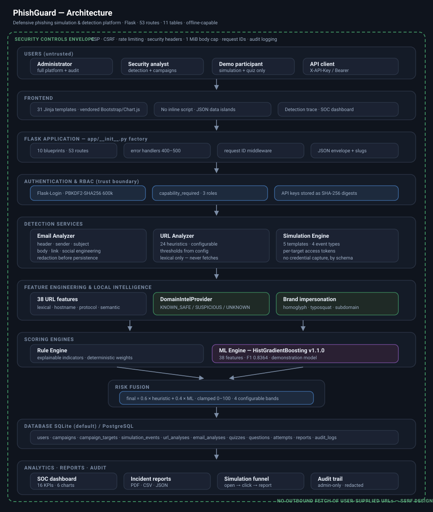

# PhishGuard — Architecture



> If the diagram does not render in your viewer, open `docs/architecture.svg`
> directly in a browser.

---

## 1. Design goals

| Goal | How it shapes the code |
|---|---|
| **Defensive only** | The simulator can physically not collect a credential: no `<input type="password">` exists anywhere under `app/templates/simulator/`, and a test asserts it (`test_simulator_templates_contain_no_credential_inputs`). |
| **Explainable** | Every score is decomposed. Rule indicators carry `points`, `evidence` and `recommendation`; the ML model exposes per-feature z-score attributions; the risk engine returns a step-by-step `explanation` list. |
| **Layered** | Routes never touch the ORM directly for business logic; services never import Flask view helpers; models never import services. |
| **Honest** | Benchmarks, confidence values and campaign rates are always rendered with the caveat that produced them. |
| **Runs anywhere** | SQLite + a vendored front-end (no CDN) means `python run.py` works offline; PostgreSQL + Redis are swapped in by environment variable for `docker compose`. |

---

## 2. Layer map

```
Browser / API client / CLI
        │
        ▼
┌──────────────────────────────────────────────────────────────┐
│  Security middleware                                         │
│  CSRFProtect · Flask-Login · @capability_required            │
│  Flask-Limiter · MAX_CONTENT_LENGTH · validators             │
│  after_request → CSP + hardening headers                     │
└──────────────────────────────────────────────────────────────┘
        │
        ▼
┌──────────────────────────────────────────────────────────────┐
│  app/routes/*.py  — 10 blueprints, 53 routes                 │
│  thin: parse → authorise → call a service → render/serialise │
└──────────────────────────────────────────────────────────────┘
        │
        ▼
┌───────────────────────────────┐   ┌──────────────────────────┐
│  app/services/*.py            │◄─►│  app/ml/*.py             │
│  url_analyzer   email_analyzer│   │  feature_engineering     │
│  risk_engine    ml_detector   │   │  train · predict         │
│  campaign_service             │   │  model.joblib            │
│  report_service               │   │  metrics.json            │
│  simulation_templates         │   └──────────────────────────┘
│  awareness_content            │
└───────────────────────────────┘
        │
        ▼
┌──────────────────────────────────────────────────────────────┐
│  app/models/*.py — SQLAlchemy ORM (11 tables)                │
│  Alembic migrations in migrations/versions/                  │
│  SQLite (dev/test) · PostgreSQL (compose)                    │
└──────────────────────────────────────────────────────────────┘
```

### Dependency rule

`models` ← `services` ← `routes`.
`app/utils/` is a leaf package (formatting, validation, redaction, audit,
decorators, security headers) that anything may import. `app/ml/` depends on
nothing inside the app except `app/config.py` paths, so `python -m app.ml.train`
runs without a Flask context.

---

## 3. Request lifecycle (URL analysis)

1. `POST /url-detector` arrives. `MAX_CONTENT_LENGTH` (1 MB) rejects oversized bodies with 413.
2. `CSRFProtect` validates `csrf_token`; failure → 400 with the friendly error page.
3. `@login_required` → `@capability_required("analysis.run")` → 403 for a Demo User.
4. `@limiter.limit(_analysis_limit)` applies `RATELIMIT_ANALYSIS` (a callable, so the value is read from config at request time).
5. `validate_url()` normalises the string and rejects anything that is not `http`/`https` — `javascript:`, `data:`, `file:` and `ftp:` are refused **before** the scheme-adding normaliser can disguise them.
6. `url_analyzer.analyze(url)` returns a rule verdict: 0–100 score plus a list of indicators.
7. `ml_detector.predict(url)` loads the joblib bundle once per process and returns a probability plus z-score attributions.
8. `risk_engine.combine(...)` fuses them with the configured weights and produces a band, a recommendation and an ordered `explanation`.
9. A `URLAnalysis` row is persisted; `log_audit()` records *that* an analysis happened (hostname, classification, score) — never the analyst's session or key.
10. `detectors/url_result.html` renders the verdict, the indicator table, the parsed structure, the feature vector and the ML panel, and emits a `<script type="application/json" id="detector-data">` block that `detector.js` reads to draw the charts (no inline JS, so the strict CSP holds).

---

## 4. The hybrid risk engine

```
final = clamp( heuristic × HEURISTIC_WEIGHT + ml × ML_WEIGHT , 0 , 100 )      # ML available
final = heuristic                                                             # ML unavailable
```

Defaults: `HEURISTIC_WEIGHT=0.6`, `ML_WEIGHT=0.4` (both configurable in `.env`).
The engine normalises the pair so the weights always sum to 1, and when the
model is missing or disabled it degrades to pure rules and says so in `notes`.

| Band | Range | Meaning |
|---|---|---|
| LOW | 0–24 | No strong signals. Not a guarantee of safety. |
| MEDIUM | 25–49 | Worth a second look before interacting. |
| HIGH | 50–74 | Treat as hostile until verified out-of-band. |
| CRITICAL | 75–100 | Multiple independent phishing signals. |

**Why a hybrid?** The rule engine is auditable and never surprises a reviewer,
but it only knows the patterns somebody wrote down. The model generalises to
combinations nobody enumerated, but it cannot justify itself in operator
language. Weighting them keeps the explanation legible while adding statistical
reach — and because the weights are configuration, an analyst can dial the model
out entirely (`ML_WEIGHT=0`) if they do not trust it in their environment.

---

## 5. Data model

| Table | Purpose | Notable columns |
|---|---|---|
| `users` | Accounts + RBAC | `password_hash` (PBKDF2-SHA256), `role`, `api_key`, `failed_login_count`, `locked_until` |
| `campaigns` | Simulation definition | `template_key`, `status`, `difficulty`, `organization` |
| `campaign_targets` | Enrolment | `simulated_message_id` (`SIM-XXXXXXXX`), `access_token` (`secrets.token_urlsafe(24)`), unique on `(campaign_id, user_id)` |
| `simulation_events` | Interaction log | `event_type` ∈ 4 values only, `demo_user_ref`, `occurred_at` |
| `url_analyses` | URL verdicts | scores, `indicators` JSON, `features` JSON, `explanation` JSON |
| `email_analyses` | Email verdicts | `body_excerpt` (**redacted + truncated**), `header_findings` JSON |
| `awareness_quizzes` / `quiz_questions` / `quiz_attempts` | Training | `answers` JSON with per-question explanation |
| `reports` | Saved evidence | `payload` JSON, `subject_type`, `subject_id` |
| `audit_logs` | Security trail | `action`, `category`, `status`, `actor_username`, sanitised `extra` |

`simulation_events` deliberately has **no** column that could hold a submitted
value. The schema itself is the control.

### Retention, deletion and what is deliberately never stored

PhishGuard has **no automated retention or purge job.** Rows live until
something deletes them. That is a deliberate scope decision for a demonstration
platform, and it is stated here rather than implied by silence.

**What deletes what.** Every user- and campaign-owned table is wired with
`cascade="all, delete-orphan"` on the ORM side *and* `passive_deletes=True`
with database-level `ON DELETE CASCADE`, and SQLite foreign keys are enforced
by a `PRAGMA foreign_keys=ON` connection listener (they are off by default in
SQLite, which would have let orphans accumulate silently).

| Deleting… | Also removes |
|---|---|
| a `User` | their `campaign_targets`, `simulation_events`, `quiz_attempts` |
| a `Campaign` | its `campaign_targets` and `simulation_events` |
| an `AwarenessQuiz` | its `quiz_questions` and `quiz_attempts` |

`audit_logs`, `url_analyses`, `email_analyses` and `reports` use
`ON DELETE SET NULL` on their actor/owner foreign key, so they are **not**
cascaded away with the actor. An audit trail that disappears when you delete
the account it incriminates is not an audit trail; the log keeps
`actor_username` and `actor_role` as denormalised strings precisely so the
record survives the account.

**What is never written in the first place.** Retention risk is managed mostly
by not collecting:

* `simulation_events` has **no column** that could hold a submitted value — no
  `password`, no `form_data`, no `payload`. The schema is the control, and
  `SIMULATION_COLLECT_CREDENTIALS` is a hard `False`.
* Submitted email bodies pass through `redact_sensitive()` before persistence:
  passwords, OTP/PIN codes, bearer tokens and API keys, JWT-shaped strings,
  13–19 digit card numbers, CVVs, IBAN/account numbers and SSN-shaped strings
  are replaced with `[REDACTED]`. The stored `body_excerpt` is additionally
  capped at 4,000 characters by `safe_excerpt()`.
* `AuditLog.extra` is sanitised by `_sanitise_extra()` before the row is
  written. This is a *key*-based control, not the regex redactor: any key in
  `_FORBIDDEN_KEYS` (`password`, `token`, `api_key`, `secret`, `cookie`,
  `cvv`, `iban`, `otp`, `body`, …) is replaced with `[REDACTED]`, and every
  surviving value is coerced to a scalar and truncated (256 chars for strings,
  20 items for collections). It stops the known-sensitive field names and
  bounds the blast radius; it does **not** scan free text, which is why
  callers redact content themselves before passing it in.
* Passwords exist only as PBKDF2-SHA256 hashes; API keys are shown once at
  rotation and stored as opaque strings.

**Purging manually.** There is no UI for bulk deletion. Use the shell:

```bash
flask shell
>>> from app.extensions import db
>>> from app.models import AuditLog
>>> from datetime import datetime, timedelta, timezone
>>> cutoff = datetime.now(timezone.utc) - timedelta(days=90)
>>> AuditLog.query.filter(AuditLog.created_at < cutoff).delete()
>>> db.session.commit()
```

Or reset everything to a known demo state with
`python scripts/seed_database.py --reset`, which drops and recreates all
tables. If you deploy this beyond a demo, add a scheduled job implementing
your own retention period — the cascade wiring above means deleting the parent
row is enough.

---

### Awareness score

```
score = 60 (baseline)
      − 5   per OPENED
      − 25  per LINK_CLICKED
      + 10  per TRAINING_PAGE_VIEWED
      + 30  per REPORTED
clamped to 0…100
```

---

## 6. Machine-learning pipeline

```
scripts/build_dataset.py            →  data/datasets/url_dataset.csv  (16,083 rows)
        │  PhiUSIIL (UCI ID 967, CC BY 4.0) + generated augmentation corpus
        │  balance_confounds(): rewrites ONLY scheme and "www." in BOTH classes
        ▼
app/ml/feature_engineering.py       →  38 ordered numeric features
        ▼
app/ml/train.py                     →  LogisticRegression | RandomForest | HistGradientBoosting
        │  stratified 80/20 split · 5-fold CV on F1 · permutation importance
        ▼
app/ml/model.joblib (349 KB) + app/ml/metrics.json
        ▼
app/ml/predict.py                   →  probability, risk score, z-score attributions
        ▼
app/services/ml_detector.py         →  Flask-aware wrapper (lazy load, config gate)
```

### The label leak we had to fix

In the raw PhiUSIIL corpus **100 %** of legitimate URLs begin `https://www.`,
while phishing URLs are 48.7 % HTTPS / 41.4 % `www.`. A model trained on that
split reaches ~99.7 % accuracy by learning **“http ⇒ phishing”** — a rule that
directly contradicts the advice this very platform teaches (*HTTPS says nothing
about intent*). `balance_confounds()` rewrites only the scheme and the `www.`
prefix, in **both** classes, toward ~60 % HTTPS / ~45 % `www.`. Hostnames, paths
and queries are untouched. Accuracy drops to a believable ~88 % and `is_https`
falls out of the top features. `--no-balance` exists purely to demonstrate the
leak in a viva.

**Second confound — path depth.** A later audit found `path_length` had become
the strongest feature (permutation importance 0.276): PhiUSIIL stores its
legitimate class as bare registered domains (85 % with no path) while phishing
rows were captured live with deep paths (62 % with a path). The model was
scoring *any* URL with a path as phishing — `github.com/pallets/flask` at 85.1.
`balance_path_depth()` equalises path presence and depth in **both** classes:
path-less URLs get one from a single class-neutral vocabulary, and a matching
share of both classes is stripped to the bare host. Authentic path wording is
never rewritten. Both classes end near 70 % with-path, `path_length` importance
falls to 0.028 (rank 12), and the same URL now scores 24.8.

### Held-out results (n = 3,217; 1,589 legitimate / 1,628 phishing)

| Model | Accuracy | Precision | Recall | F1 | ROC-AUC | 5-fold CV F1 |
|---|---|---|---|---|---|---|
| Logistic Regression | 0.8206 | 0.8972 | 0.7291 | 0.8045 | 0.8682 | 0.806 ± 0.008 |
| Random Forest (200, d18, leaf3) | 0.8415 | 0.9465 | 0.7279 | 0.8229 | 0.8978 | 0.814 ± 0.006 |
| **HistGradientBoosting (selected)** | **0.8514** | **0.9444** | **0.7506** | **0.8364** | **0.8990** | **0.830 ± 0.006** |

Selected-model confusion matrix `[[1517, 72], [406, 1222]]` → 72 false
positives, 406 false negatives (one phishing URL in four is missed). Top
permutation importances: `suspicious_tld` 0.155, `num_subdomains` 0.115,
`host_digit_ratio` 0.113, `hostname_length` 0.098, `has_www_in_subdomain`
0.094, `num_suspicious_keywords` 0.071.

Removing the two confounds cost 3.4 points of accuracy and 3.9 of F1 versus the
leaky model (0.8857 / 0.8755). Those earlier numbers were partly measuring
collection artefacts. This is a **demonstration model**: the pipeline is real
and reproducible with `python train.py`, but the corpus is a public research
dataset, not organisational traffic.

An unbounded Random Forest scored similarly but produced a **44 MB** artefact;
HistGradientBoosting gives better metrics in **349 KB**, which is why it ships.

---

## 7. Front-end architecture

* **No CDN.** Bootstrap 5.3.3, Chart.js 4.4.3 and Bootstrap Icons 1.11.3 are vendored under `app/static/vendor/`, so the app works with no internet access and under a strict CSP.
* **No inline script.** `script-src 'self'` is enforced. Views hand data to JS through `<script type="application/json">` islands (`dashboard-data`, `campaign-data`, `detector-data`) that the bundles parse on load.
* **Declarative behaviour.** `app.js` implements `data-nav-toggle`, `data-copy`, `data-fill-target`, `data-confirm`, `data-check-all`, `data-filter-table`, `data-autodismiss` — no page-specific inline handlers.
* **Charts.** Ten canvases across the app: `chartActivity`, `chartRisk`, `chartAccuracy`, `chartCampaigns`, `chartSplit`, `chartAwareness` (dashboard); `chartFunnel`, `chartTimeline` (campaign detail); `chartIndicators`, `chartAttribution` (detector results).

---

## 8. Extension points

| Want to… | Do this |
|---|---|
| Add a detection rule | Append an `Indicator` in `app/services/url_analyzer.py` (24 today) (or `email_analyzer.py`). Score, UI, API, CSV and PDF pick it up automatically. |
| Add a simulation template | Add a `SimulationTemplate` to `app/services/simulation_templates.py` with `indicators` and `teaching_points`. |
| Swap the model | Change the candidate list in `app/ml/train.py`, re-run `python -m app.ml.train`. The bundle contract (`model`, `feature_names`, `feature_means`, …) is what `predict.py` relies on. |
| Add a quiz question | Append to `QUESTIONS` in `app/services/awareness_content.py`; `ensure_default_quiz()` syncs it on next boot. |
| Add a capability | Add it to `Role.CAPABILITIES` and guard the view with `@capability_required("your.capability")`. |
